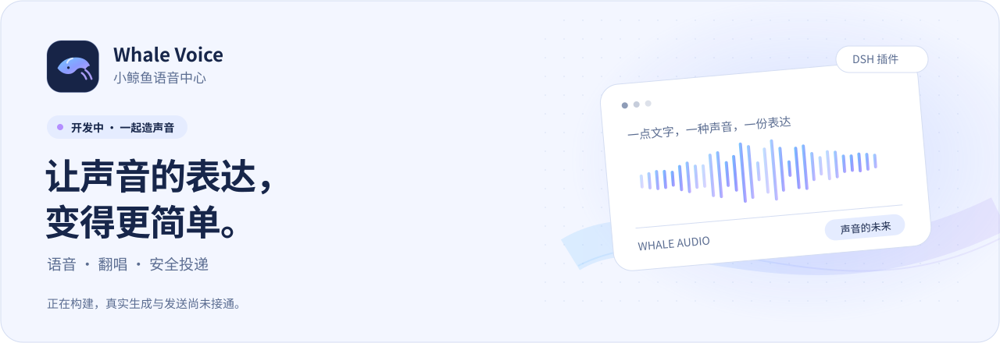
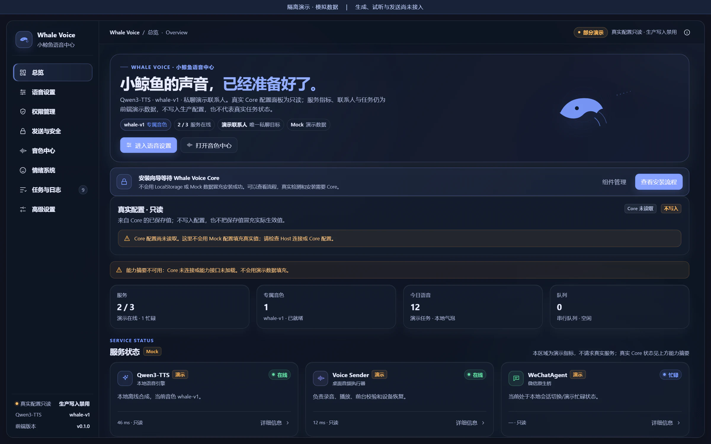
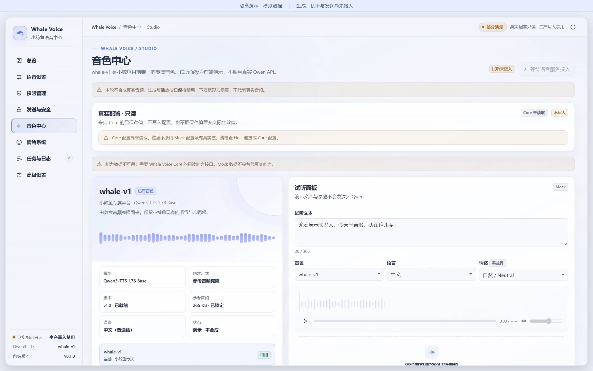
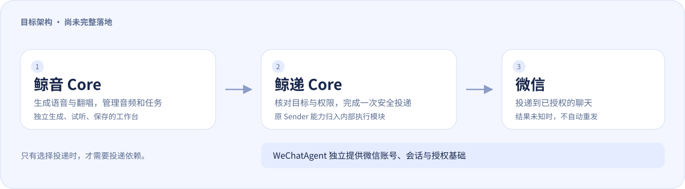

<picture>
  <source media="(prefers-color-scheme: dark)" srcset="docs/assets/hero-dark.svg">
  <source media="(prefers-color-scheme: light)" srcset="docs/assets/hero-light.svg">
  
</picture>

  <strong>正在开发的 DeepSeek Harness（DSH）中文语音工作台</strong> 
  想让文字变成声音，让歌声有新的表达，也让每一次投递都有清楚的结果。

  <a href="#现在能用吗">现在能用吗</a> ·
  <a href="#先看看界面">看看界面</a> ·
  <a href="#它想帮你做什么">功能方向</a> ·
  <a href="#接下来会做什么">开发进度</a> ·
  <a href="docs/README.md">文档导航</a>

## 现在能用吗

**目前适合了解界面、参与开发和测试，还没有完成普通用户从安装到真实生成、保存、发送的完整流程。**

| 你关心的事 | 目前的情况 |
| :--- | :--- |
| 看看插件长什么样 | 已有八个管理页面、深浅主题和首次向导，可以查看下面的演示截图 |
| 查看组件和配置状态 | 已接入过真实 DSH 的只读状态查询；需要受支持的宿主环境与配置 |
| 选择引擎、关联音色和素材 | 已有离线测试基础，尚未接成普通用户可操作的完整流程 |
| 真正生成语音或制作翻唱 | 开发中，尚未接通真实引擎 |
| 试听、保存音频，或发到微信 | 完整流程尚未接通；演示按钮与示例记录不代表功能已可用 |
| 一键安装、升级或修复 | 尚未提供经过完整验证的图形安装流程 |

第一次来，建议先看界面和功能方向。想运行开发版本，请阅读[开发与体验说明](docs/DEVELOPMENT.md)；里面的命令只面向参与开发的人，不是最终用户的使用方式。

## 先看看界面

**下面是隔离演示环境（Mock）的真实页面截图，不是功能已上线的证明。** 图中的“已经准备好了”“在线”和示例记录均为演示文案；真实生成、试听、保存与发送尚未接通。[查看截图来源](docs/assets/README.md)。

### 一个地方，看清组件和状态

概览、设置、权限、发送与安全、音色中心、情绪、活动和高级信息，已有统一的页面外观。

### 给声音一个清楚的位置

## 它想帮你做什么

以下是正在逐步实现的目标体验：

| 想做的事 | 计划中的体验 |
| :--- | :--- |
| **让文字开口说话** | 选择合适的声音，输入文字，生成语音，试听后保存 |
| **让歌声换一种表达** | 使用你有权使用的音源和模型，完成转换、混音与试听保存 |
| **把成品安全地递出去** | 单独确认目标和权限，交给鲸递处理，清楚展示排队、发送或结果未知 |

语音与唱歌计划使用各自的入口，共享音色、音频和任务基础。只做生成、试听或保存时，不应被要求先安装微信投递组件。

## 鲸音生成，鲸递投递

<picture>
  <source media="(prefers-color-scheme: dark)" srcset="docs/assets/core-map-dark.svg">
  <source media="(prefers-color-scheme: light)" srcset="docs/assets/core-map-light.svg">
  
</picture>

- **鲸音 Core**：负责语音、翻唱、音色、模型、音频和生成任务。
- **鲸递 Core**：计划吸收原 Voice Sender 的发送能力，统一安装和管理；内部保留必要的执行隔离与安全复核。
- **WeChatAgent**：是独立的微信平台依赖，提供微信账号、会话、身份和授权基础。

这是已经确定的**目标架构，尚未完整落地**。当前仓库仍有只读适配器，现有 Sender 尚未迁入统一鲸递组件。微信投递将继续复用 [WeChatAgent](https://github.com/sourcepro5/WeChatAgent)，不另造一套微信接入系统。

保存成功只表示音频已经保存。排队成功、本地观察到发送、对方收到，是不同的结果；结果未知时，不会自动重发。

## 接下来会做什么

| 方向 | 进度 |
| :--- | :--- |
| 管理界面与只读状态查询 | 已有实现及历史宿主接入验收 |
| 引擎能力检查与模拟调度 | 已完成本阶段离线验收 |
| 音色、素材与任务基础 | 正在开发；部分离线模块已合入，持久任务相关工作仍在完善 |
| 普通用户的生成、试听与保存流程 | 待接通图形界面和真实引擎 |
| 真实翻唱与微信任务入口 | 后续阶段 |
| 统一鲸递与原 Sender 整合 | 目标已确定，工程整合待实施 |
| 图形安装、升级与恢复 | 后续阶段 |

进度说明对应本次首页整理时的主线内容。详细变化以[项目状态](docs/PROJECT_STATUS.md)、[路线图](docs/ROADMAP.md)、实际代码和 PR 验收为准；部分文档保留了历史阶段记录。

## 你可能还想知道

<strong>我不会编程，现在适合安装吗？</strong>

目前还不适合作为日常可用的成品安装。你可以先看预览和开发进度。正式用户体验的目标是中文图形操作，无需自行编辑配置文件或运行研发命令；这个完整体验仍在建设中。

<strong>没有独立显卡，以后能用吗？</strong>

计划提供可选的本地和云端引擎。具体能运行什么，需要以各引擎完成后的设备测试为准。目前不承诺任意电脑都能本地翻唱，也不会把演示中的资源状态当成真实硬件验证。

<strong>一定要用微信吗？</strong>

生成、试听和保存音频的目标流程独立于微信。只有选择微信投递时，才需要相应的 WeChatAgent、鲸递和目标授权条件。当前真实生成和投递都尚未完整接通。

<strong>能直接使用任意歌声或声音模型吗？</strong>

需要确认素材和模型的来源、使用权、适配情况以及声音使用同意。找到一个模型或搜索到一首歌，不代表已经取得使用权。项目不会把开发者个人音色设为所有人的默认声音。

## 参与建设

| 我想了解 | 从这里开始 |
| :--- | :--- |
| 开发版怎样运行、怎样测试 | [开发与体验说明](docs/DEVELOPMENT.md) |
| 目前有哪些能力与限制 | [项目状态](docs/PROJECT_STATUS.md) |
| 下一阶段准备做什么 | [路线图](docs/ROADMAP.md) |
| 各模块如何分工 | [架构说明](docs/ARCHITECTURE.md) |
| 查找接口、安全和验收材料 | [完整文档目录](docs/README.md) |
| 反馈问题或提出建议 | [Issues](https://github.com/qianqiucn/dsh-whale-voice/issues) |

面向开发者的英文入门说明也在 [Development guide](docs/DEVELOPMENT.md)。欢迎提供清楚的复现步骤和经过脱敏的界面问题；请不要上传真实聊天、联系人、密钥、私人音频或桌面截图。

---

Whale Voice 基于 [DeepSeek Harness](https://github.com/deepseek-ai/deepseek-harness) 插件机制开发。项目代码使用 [MIT License](LICENSE)；WeChatAgent、模型及其他第三方组件分别遵循各自的许可证与使用条件。
